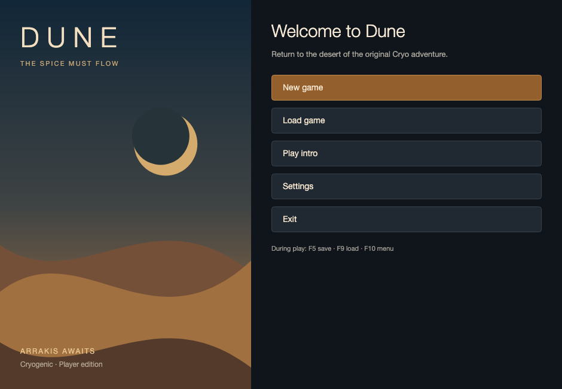
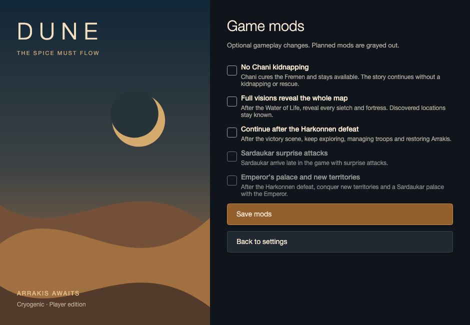

# Dune Remake Custom

A player edition of **Cryo’s Dune (1992)** with a start menu, 100 save slots, persistent settings and optional gameplay mods.

This is a fork of <a href="https://github.com/OpenRakis/Cryogenic" target="_blank" rel="noopener noreferrer">OpenRakis/Cryogenic</a>, based on version **0.1.9**. It uses the original Dune CD game through <a href="https://github.com/OpenRakis/Spice86" target="_blank" rel="noopener noreferrer">Spice86</a>, together with Cryogenic’s C# replacements and this fork’s menu and gameplay changes. You supply the original game files.

**Tested on Apple Silicon macOS.** Build instructions for Windows and Linux are included below; this fork’s gameplay and audio checks were performed on macOS.



## What this version adds

- **A start and pause menu:** New game, Load game, Play intro, Settings and Exit, plus Resume game and Save game during a session.
- **100 named save slots**, with dates, the in-game day and a backup when replacing a slot.
- **Remembered text settings:** the original Subtitles, Balloons and No subtitles choices. Balloons are enabled by default, and changes made in the original mixer are also remembered.
- **Three independent gameplay mods:** keep Chani available, reveal the map after the Water of Life, and continue playing after defeating the Harkonnens.
- **Corrected save loading**, including the scene palette and interface artwork.
- **Mac audio corrections** for crackling and gaps, with a 120 ms playback buffer. The default game speed is **5500 cycles**, adjustable in Settings.

## How to play on macOS

### 1. Get the required files

You need the <a href="https://dotnet.microsoft.com/en-us/download/dotnet/10.0" target="_blank" rel="noopener noreferrer">.NET 10 SDK</a> to build the player, Git to clone this repository, and these files from your own **Dune CD version 3.7**:

```text
DNCDPRG.EXE
DUNE.DAT
```

The floppy edition is not supported. Original game files, CD images and personal saves are not included in this repository.

### 2. Download and build this fork

Open Terminal and run:

```sh
git clone https://github.com/pansay/dune-remake-custom.git
cd dune-remake-custom
./build-player.sh
```

The build creates the player in `.local/app/`. It includes the .NET runtime, so the built player can run without a separate runtime installation.

### 3. Add your game data and launch

Create a `dune` folder in the repository and copy your two original files into it:

```text
dune-remake-custom/
├── Play Dune.command
├── build-player.sh
└── dune/
    ├── DNCDPRG.EXE
    └── DUNE.DAT
```

Launch with:

```sh
./Play\ Dune.command
```

For later launches, you can double-click **Play Dune.command** in Finder. You can also keep the game data elsewhere: open **Settings → Choose game data folder**, select the folder containing both files, and choose **Save settings**.

### 4. Start your journey

Choose **New game** to start directly at the Atreides palace, or **Load game** to continue a save. **Play intro** runs the original introduction and then returns to the menu.

Open **Settings** to choose the text mode or game speed, then choose **Save settings**. Open **Settings → Game mods**, select the mods you want, and choose **Save mods** before starting or resuming play. All three mods are **off by default**.

## Controls and saves

The game keeps its original mouse controls. During play:

| Action | Shortcut |
| --- | --- |
| Open the save browser | **F5** |
| Open the load browser | **F9** |
| Pause and open the player menu | **F10** |

On a Mac keyboard, you may need **Fn** with the function key. The original game’s Save/Load commands also open the new slot browser. Returning to the player menu pauses the game and its audio; **Resume game** continues the session.

The Mac launcher stores saves, preferences and working copies of the game data in **`.local/user/`**. Back up that folder to keep your progress. Existing `DUNE37S*.SAV` files beside the original game files are imported when the player opens, while the slot browser is empty. If you select their folder in Settings after launch, restart the player to import them. Original files are left intact.

Saves use the original game’s native format. Each overwritten slot retains one `.previous` backup. Mod changes that have already happened in a saved campaign are retained when that campaign is loaded in this fork; the individual behaviours are explained below.

## Optional game mods

Select any combination in **Settings → Game mods → Save mods**. In a paused game, changes apply when you resume.



### No Chani kidnapping

The Fremen still fall sick, Chani still offers to help, and she still needs time to cure them. Leave her at the sick sietch as usual. Once treatment finishes, her success vision is sent and the story advances past the kidnapping and rescue chapter. **Chani stays at the cured sietch:** return to her and choose **Come with me**.

The later fortress campaign and final attack keep their normal requirements. The mod also supports an existing save where Chani is already missing after the cure: she returns to the cured sietch, or to the Atreides palace if that sietch has been lost. It does not skip unfinished treatment.

Once that story progress is saved, turning the option off does not restart the kidnapping.

### Full visions reveal the whole map

After Paul successfully drinks the **Water of Life**, all **70 locations** defined by the original game become known: sietches, fortresses, smuggler camps and both palaces. First visions alone do not activate it. Existing saves that have reached the Water of Life are supported.

Locations become visible without being marked as visited or conquered. Ownership, troops and prospecting information are preserved. Close and reopen an already open map to refresh it. Discovered locations stay known in your saves when the option is turned off.

### Continue after the Harkonnen defeat

Enable this before completing the final attack. The original victory conversation and final artwork play, then the closing credits are skipped and Paul returns to the conquered palace entrance with his travelling companions.

**Time, troop orders, spice production, travel and ecology continue.** The palace stays friendly and keeps its rooms and appearance. Returning to its throne room does not replay the ending. The former Emperor’s tribute demands end, and saving and loading remain available.

A saved continued campaign stays playable when the option is later turned off. To see the original ending again, load a save from before victory with the option disabled.

### Planned mods

Two further options appear grayed out in Settings and are **not implemented yet**:

- Late-game **Sardaukar surprise attacks**.
- **The Emperor’s palace and new territories** to conquer after the Harkonnen defeat.

The current continuation mod uses the existing map; those additional territories and enemies have not been added.

## Windows and Linux builds

These targets use the same player code. The Mac instructions above describe the platform on which this fork has been tested.

**Windows x64**, from PowerShell in the repository folder:

```powershell
dotnet publish src/Cryogenic/Cryogenic.csproj -c Release -r win-x64 --self-contained true -o .local/app
$env:CRYOGENIC_PLAYER_HOME = Join-Path (Get-Location) '.local/user'
.\.local\app\Cryogenic.exe --player
```

**Linux x64 or ARM64**, from the repository folder:

```sh
./build-player.sh
CRYOGENIC_PLAYER_HOME="$PWD/.local/user" ./.local/app/Cryogenic --player
```

On either platform, put `DNCDPRG.EXE` and `DUNE.DAT` in `dune/`, or select their folder in Settings. Setting `CRYOGENIC_PLAYER_HOME` as shown keeps saves and preferences in the repository’s `.local/user/` folder. Without it, launching the executable directly uses the operating system’s application-data folder under `CryogenicPlayer`.

## Troubleshooting

| Problem | What to check |
| --- | --- |
| `dotnet` is not found | Install the **.NET 10 SDK**, then reopen Terminal or PowerShell. |
| The launcher asks you to build first | Run `./build-player.sh` from the repository folder. |
| The player cannot find game data | Choose the folder containing both original CD files in Settings. |
| The executable is rejected | This player requires the CD 3.7 executable; see the checksum in the detailed player guide. |
| A mod seems inactive | Choose **Save mods**, resume the game, and check its story requirement above. Reopen the map after enabling map reveal. |
| Function keys control brightness or media | Hold **Fn** while pressing F5, F9 or F10. |

## Development and credits

The custom version lives on **`master`**. Its base is upstream tag **`v0.1.9`**, commit **`02af0c6`**. The original Cryogenic Git history is retained. For development, use `origin` for this fork and `upstream` for OpenRakis/Cryogenic.

The menu is built with Avalonia. Cryogenic and Spice86 run the original DOS game alongside C# replacements; this fork adds version-checked hooks in emulated memory for menu integration and the optional mods. Original game data is not modified on disk.

Run the menu, settings and save checks with:

```sh
dotnet run --project src/Cryogenic.Player.Checks -c Release
```

The <a href="README-PLAYER.md" target="_blank" rel="noopener noreferrer">detailed player and developer guide</a> includes the supported executable checksum, save locations, configuration options and optional native-game integration checks. Those checks exercise the original cure and victory routines, map discovery, save/load colours and continued play using isolated local game data.

The <a href="docs/UPSTREAM-README.md" target="_blank" rel="noopener noreferrer">preserved upstream README</a> documents Cryogenic’s original architecture and reverse-engineering work. Further references are in the <a href="docs/player-sources.html" target="_blank" rel="noopener noreferrer">browser-ready source list</a>.

Credit to **Kevin Ferrare, Maximilien Noal and the Cryogenic, Spice86 and Spice86.Audio contributors** for the projects this fork builds on. The Mac audio corrections are included as source with their <a href="src/Spice86.Audio/UPSTREAM.txt" target="_blank" rel="noopener noreferrer">upstream references</a> and license notices.

The Cryogenic source retains its **Apache License 2.0**; see <a href="LICENSE" target="_blank" rel="noopener noreferrer">LICENSE</a> and <a href="NOTICE" target="_blank" rel="noopener noreferrer">NOTICE</a>. Vendored audio components retain their own notices in <a href="src/Spice86.Audio/licenses/" target="_blank" rel="noopener noreferrer">their license folder</a>. Original Dune game data remains the property of its rights holders and must be supplied separately. This fork is not affiliated with or endorsed by the original rights holders.
